# 📱 VoiceToText 서비스 기획서 (PRD)
### 안드로이드 내부 오디오 실시간 텍스트 변환 + 로컬 파일(`Documents/VoiceToText`) 자동 저장 + 다국어 번역 + 파일 관리/이어쓰기 앱

| 항목 | 내용 |
| :--- | :--- |
| 문서 버전 | **v4.0 (파일 관리 전면 강화: 다른 이름 저장 · 기록 이름 변경 · 기존 파일 이어서 작성)** |
| 최종 수정일 | 2026-11-03 |
| 문서 상태 | **검토 및 기능 승인 대기 (Draft for Review)** |
| 타겟 플랫폼 | **Android 13 (API 33) 이상** (minSdk 33 / targetSdk 35) |
| STT 엔진 | **안드로이드 기본 음성 인식기 (`SpeechRecognizer`)** — 한국어/English/日本語/자동감지 |
| 번역 엔진 | **Google ML Kit Translate (온디바이스 오프라인 번역 기본)** + 선택적 고품질 클라우드 API |
| 저장 방식 | **기기 내부 로컬 저장소 전용 (`Documents/VoiceToText/*.txt`)** — 원문/번역문/이어쓰기 완전 지원 |

---

### 변경 이력
| 버전 | 일자 | 주요 변경 내용 |
| :--- | :--- | :--- |
| v1.0 | 2026-11-02 | 초안 작성 (Google Drive/Docs 연동 기반) |
| v1.1 | 2026-11-02 | STT 엔진(안드로이드 기본 인식기) 및 minSdk 33 확정 |
| v2.0 | 2026-11-02 | [로컬 전면 개편] Google Drive 의존성 완전 제거, 기기 내부 문서(`Documents/VoiceToText`) 자동 저장 |
| v2.1 | 2026-11-02 | [다국어 STT & 단축 파일명] 한국어/영어/일본어/자동감지 칩 바, 단축 파일명(`VTT_YYMMDD_HHmm.txt`), 순수 텍스트 포맷 |
| v2.2 | 2026-11-02 | [인앱 뷰어 & UX 완성] `InAppTextViewerDialog` 탑재, 하늘색/파란색 버튼 표준화, FlowRow 메타데이터 줄바꿈, 삭제 확인 다이얼로그 |
| v3.0 | 2026-11-02 | [다국어 자동 번역] Google ML Kit 온디바이스 오프라인 번역 탑재, 인앱 3-Way 대조 뷰어, 실시간 번역 자막 스트리밍 |
| **v4.0** | **2026-11-03** | **[파일 관리 & 세션 이어쓰기 전면 강화]**<br>• **변환 텍스트 파일 저장 시 "다른 이름으로 저장하기" (REQ-17)**: 기본 타임스탬프 파일명을 사용자가 원하는 제목(예: `20261103_주간회의.txt`)으로 즉시 변경/보관<br>• **변환이력에서 파일 이름 변경 (REQ-18)**: 기록 목록의 더보기 메뉴 및 문서 상세 화면 상단에서 파일명 즉시 인라인 수정<br>• **변환 시작 시 기존 파일 선택 후 "이어서 작성하기" (REQ-19)**: 기존 회의록/강의노트 파일에 새로운 음성 인식을 이어 붙여 누적 기록 |

---

## 1. 프로젝트 개요

### 1.1 배경 및 목적
기존 VoiceToText v2.2는 스마트폰 내부 사운드를 마이크 없이 캡처하여 깨끗한 텍스트 파일로 자동 저장하는 온디바이스 유틸리티로서 높은 완성도를 확보하였다.  
그러나 **유튜브 해외 강연, 글로벌 팟캐스트, 외국어 온라인 미팅, 해외 뉴스** 등을 시청하는 사용자들은 **"인식된 외국어 텍스트를 즉시 한국어로 읽고 싶다"**거나, 반대로 **"한국어 회의록을 영어/일본어 리포트로 즉시 변환하여 공유하고 싶다"**는 강력한 니즈를 가지고 있다.

v3.0에서는 기존의 **100% 오프라인 & 프라이버시 보호(Zero-Cloud)** 철학을 계승하면서, 기기 내부에서 스스로 구동되는 **온디바이스 번역 엔진(Google ML Kit Translate)**을 결합하여 **변환 완료 파일 번역** 및 **실시간 청취 중 자막 번역** 기능을 제공한다.

### 1.2 핵심 가치 (Core Value)
1. **100% 오프라인 & 프라이버시 유지 (On-Device Translation)**:
   - 번역 작업을 위해 텍스트를 제3자 외부 번역 서버로 전송하지 않고, 스마트폰 내부 NPU/CPU에서 로컬 머신러닝 모델로 직접 번역을 수행합니다. 기밀 회의록이나 개인 메모도 안심하고 번역할 수 있습니다.
2. **원문-번역문 직관적 비교 (Bilingual Parallel View)**:
   - 번역된 텍스트만 덩그러니 보여주는 것이 아니라, 문단 단위로 원문과 번역문을 나란히 비교하며 학습하거나 검토할 수 있는 인앱 대조 뷰어를 제공합니다.
3. **실시간 자막 스트리밍 (Live Subtitle Mode)**:
   - 영어 유튜브 영상을 들을 때 실시간으로 인식된 영어 문장 바로 아래에 한국어 해석 자막이 1~2초 내에 즉시 표시되어 실시간 번역 자막기 역할을 합니다.
4. **표준 번역 파일 영구 보관 (Export & Portability)**:
   - 번역문 전용 텍스트 파일(`*_trans_en.txt`) 및 대조 텍스트 파일(`*_bilingual.txt`)을 로컬 문서 폴더에 자동으로 생성하여, 외부 메신저나 PC로 손쉽게 내보낼 수 있습니다.

### 1.3 기능 범위 (Scope v4.0)
| 구분 | v3.0 (이전 배포본) | **v4.0 (신규 추가: 파일 관리 & 이어쓰기)** |
| :--- | :--- | :--- |
| **파일 저장 (Save As)** | `VTT_YYMMDD_HHmm.txt` 자동 고정 저장 | • 완료 화면에서 **[✏️ 다른 이름으로 저장]** 제공<br>• 사용자가 원하는 파일명(예: `주간전략회의.txt`) 직접 지정<br>• 특수문자 필터링, 확장자(`.txt`) 자동 보정, 중복 방지 (원터치 접두어 없이 깔끔한 입력창) |
| **기록 파일명 변경** | 파일명 수정 불가 (읽기 전용) | • 기록 목록 더보기(`⋮`) ➔ **[✏️ 이름 변경]**<br>• 문서 상세 화면 헤더 ➔ **[✏️]** 인라인 수정<br>• 물리 파일명, Room DB, 연계 번역 파일 일괄 변경 |
| **세션 이어쓰기 (Append)** | 항상 새 파일로만 시작 | • 대기 화면에서 **[📄 기존 파일에 이어서 작성]** 진입<br>• 문서 상세에서 **[🎙️ 이 문서에 이어서 작성]**<br>• 이전 기록과 인위적인 구분선 없이 자연스러운 단일 문서 흐름으로 누적 저장 |
| **번역 엔진** | Google ML Kit On-Device Translation | 기존 온디바이스 번역 기능 100% 유지 연동 |
| **저장 파일 규격** | 원문 1개 파일 + 번역 2개 파일 | • 이어쓰기 시 기존 텍스트 끝에 자연스럽게 누적<br>• 파일명 변경 시 `*_trans_*.txt` 자동 동기화 |

---

## 2. 핵심 변경 및 의사결정 (v4.0)

| No | 구분 | 기존 사양 | **v4.0 신규 사양** | 의사결정 근거 |
| :--- | :--- | :--- | :--- | :--- |
| **D-17** | **다른 이름으로 저장 UX** | 자동 생성 타임스탬프 고정 | **완료 화면 내 `[✏️ 파일명 변경/다른 이름 저장]` 모달 제공 (입력창 단독 구성)** | 불필요한 접두어 태그 없이 사용자가 의도한 파일명을 신속하고 직관적으로 입력 가능하도록 단순화 |
| **D-18** | **변환이력 파일명 변경** | 이름 변경 기능 없음 | **기록 카드 팝업 메뉴 + 상세 화면 헤더 원터치 다이얼로그** | 이전 녹음 건에 대해 사후에 프로젝트명, 회의명 등을 부여하여 체계적 자산화 지원 |
| **D-19** | **기존 파일 이어쓰기 아키텍처** | 매번 신규 `DocumentEntity` 생성 | **기존 `DocumentEntity` 재사용 및 `TranscriptEntity` 누적 추가** | 하나의 회의/강의를 여러 번 끊어서 녹음하더라도 단일 문서 및 파일로 통합 관리 |
| **D-20** | **이어쓰기 파일 포맷 & UI** | N/A | **이전 기록과 구분선 없는 자연스러운 연속 문단 누적** | 인위적인 장식선이나 구분자로 인한 시각적 방해를 제거하고, 원래 하나였던 문서처럼 깔끔한 가독성 보장 |
| **D-21** | **파일명 유효성 및 보안** | 고정 포맷 | **OS 금지 문자(`\ / : * ? " < > |`) 실시간 차단 + `.txt` 자동 접미** | 안드로이드 파일 시스템 에러 방지 및 악의적 경로 탐색(Path Traversal) 원천 차단 |

---

## 3. 요구사항 상세 매핑 (Requirements Mapping)

| 번호 | 요구사항 명세 | 세부 구현 방안 |
| :--- | :--- | :--- |
| **REQ-17** | **변환 완료 후 다른 이름으로 저장** | • 변환 완료 화면(`CompletedView`)의 파일 정보 카드 옆 `[✏️]` 아이콘 또는 액션 버튼 터치 시 `SaveAsDialog` 표시<br>• 기존 파일명(확장자 제외)이 입력 필드에 기본 채워짐 (원터치 접두어 없이 깔끔한 입력창)<br>• 유효성 검사 통과 시 `File.renameTo()`, Room DB `DocumentEntity.title` / `localFilePath` 갱신, `MediaScannerConnection` 동기화 |
| **REQ-18** | **변환이력 파일 이름 변경** | • `HistoryScreen` 목록 항목의 옵션 메뉴(`⋮`) ➔ `[✏️ 이름 변경]`<br>• `DocumentDetailScreen` 및 `InAppTextViewerDialog` 상단 타이틀 옆 `[✏️]` 터치<br>• `RenameFileDialog`에서 새 파일명 입력 후 변경<br>• 연동된 번역문 파일(`_trans_*.txt`, `_bilingual.txt`)이 존재할 경우 파일명 일괄 동기화 |
| **REQ-19** | **기존 파일 선택 후 이어서 작성 (Append)** | • `IdleView`에 `[📄 기존 파일에 이어서 작성]` 보조 CTA 배치<br>• `DocumentDetailScreen` 하단에 `[🎙️ 이 문서에 이어서 작성]` 액션 배치<br>• `AppendDocumentPickerSheet`에서 기존 문서 목록(최근순, 검색 지원, 마지막 문장 미리보기) 제공<br>• 대상 문서 선택 시 `LiveTranscribeService`에 `EXTRA_APPEND_DOCUMENT_ID` 전달<br>• 실시간 화면 상단에 `[🔄 이어 작성 중]` 배지 표시 및 기존 문장들을 본문에 자연스럽게 연속 렌더링 (구분선 없음)<br>• 새 음성 인식 결과는 기존 파일 끝에 구분선 없이 개행되어 자연스럽게 실시간 추가 기록 |

---

## 4. 사용자 플로우 (User Journey Flow)

```mermaid
flowchart TD
    subgraph "1. 다른 이름으로 저장 (REQ-17)"
        A1["실시간 변환 완료 (VTT_261103_0917.txt)"] --> A2["완료 화면 내 [✏️ 다른 이름으로 저장] 터치"]
        A2 --> A3["SaveAsDialog 팝업 (기존 파일명 기본 입력됨)"]
        A3 --> A4["사용자가 파일명 수정 (예: 주간_팀회의_녹음)"]
        A4 --> A5{"파일명 검증 (특수문자/중복)"}
        A5 -- "중복/오류" --> A3
        A5 -- "정상" --> A6["물리 파일 renameTo() + Room DB Title/Path 갱신"]
        A6 --> A7["완료 화면 파일명 즉시 갱신 및 내 파일 동기화"]
    end

    subgraph "2. 변환이력 파일명 변경 (REQ-18)"
        B1["변환 기록 목록 또는 문서 상세 화면"] --> B2["[⋮] 메뉴 ➔ [이름 변경] 또는 헤더 [✏️] 터치"]
        B2 --> B3["RenameFileDialog 팝업"]
        B3 --> B4["새 파일명 입력 및 확인"]
        B4 --> B5["물리 파일 + DB + 연동 번역본 파일명 일괄 변경"]
        B5 --> B6["기록 목록 및 상세 화면 리액티브 자동 반영"]
    end

    subgraph "3. 기존 파일에 이어서 작성 (REQ-19)"
        C1["메인 대기 화면 [기존 파일에 이어서 작성] 터치"] --> C2["AppendDocumentPickerSheet 바텀시트 오픈"]
        C2 --> C3["기존 파일 목록 검색 / 선택 (마지막 문장 미리보기)"]
        C3 --> C4["[🎙️ 이 파일에 이어서 녹음 시작] 터치"]
        C4 --> C5["LiveTranscribeScreen 진입 (이어 작성 모드)"]
        C5 --> C6["기존 문단 뒤에 구분선 없이 자연스러운 실시간 스트리밍 지속"]
        C6 --> C7["새로운 음성인식 문단이 기존 파일 끝에 자연스럽게 누적 저장"]
        C7 --> C8["종료 시 누적 통계(시간, 문장 수) 반영 및 단일 파일 완성"]
    end
```


    
    B -- "1. 인앱 뷰어 열기" --> C["인앱 텍스트 뷰어 (원문 표시)"]
    C --> D["상단 [🌐 번역] 탭 또는 번역 버튼 터치"]
    
    B -- "2. 즉시 번역하기" --> D
    
    D --> E{"해당 언어 온디바이스 모델 설치 여부"}
    E -- "미설치" --> F["언어 모델 다운로드 팝업 (약 30MB) ➔ 다운로드 완료"]
    E -- "설치됨" --> G["온디바이스 번역 엔진 가동 (문단별 순차 번역)"]
    F --> G
    
    G --> H["번역 완료 (프로그레스 100%)"]
    H --> I["인앱 뷰어 화면 전환"]
    
    I --> J1["[원문 탭]: 원문 텍스트만 표시"]
    I --> J2["[번역문 탭]: 번역문 텍스트만 표시 + [번역문 복사/공유]"]
    I --> J3["[대조 탭]: 원문과 번역문이 문단별로 나란히 매칭"]
    
    H --> K["로컬 폴더에 VTT_..._trans_en.txt 자동 저장"]
    K --> L["내 파일 앱 및 변환 기록 탭에 '🌐 EN 번역됨' 배지 자동 갱신"]
```

---

## 5. 번역 파일 저장 규격 (File Specification)

### 5.1 파일 명명 규칙
1. **원문 파일**: `VTT_261102_1437.txt` (기존 동일)
2. **번역문 단독 파일**: `VTT_261102_1437_trans_en.txt` (언어 코드: `en`, `ja`, `zh`, `ko`, `es` 등)
3. **원문+번역문 대조 파일 (옵션)**: `VTT_261102_1437_bilingual.txt`

### 5.2 번역문 텍스트 파일 포맷 규격 (`*_trans_en.txt`)
```text
[번역 시작: 2026-11-02 14:40:05 | 원문: 한국어 -> 번역: English | 모델: On-Device ML Kit]

Craig made eye contact with Barbara. He winked. She didn't. She didn't even smile. In his old gift box, old letters and black-and-white photos were neatly organized.

She ran to her husband, who had just finished a job and was having a beer in the garage before hitting the rocks. The husband, a large truck driver over 195cm tall, listened quietly to his wife.

In this way, using the local storage method eliminates the need for any authentication process, and your voice is securely preserved as text even in a completely offline environment.

[번역 완료: 3개 문단 | 소요 시간: 1.2초]
```

### 5.3 대조 텍스트 파일 포맷 규격 (`*_bilingual.txt`)
```text
[대조 리포트: 한국어 / English | VTT_261102_1437]

[01] 원문: 크레이그는 바버라와 눈을 맞췄다 그는 윙크했다 그녀는 하지 않았다 심지어 웃지도 않았다...
[01] 번역: Craig made eye contact with Barbara. He winked. She didn't. She didn't even smile...

[02] 원문: 남편에게 달려갔고 그 남자는 일을 하나 끝내고 바위를 하기 전에 차고에서 맥주를 한잔하고 있었다...
[02] 번역: She ran to her husband, who had just finished a job and was having a beer in the garage...

[03] 원문: 이와 같이 로컬 저장 방식을 사용하면 인증 과정이 전혀 필요 없고...
[03] 번역: In this way, using the local storage method eliminates the need for any authentication process...
```

---

### 5.4 이어서 작성된 텍스트 파일 포맷 규격 (`Append / Resume Session`)
기존 텍스트 파일의 원문 본문을 손상하지 않고, 인위적인 구분선이나 장식선 없이 자연스러운 문맥으로 새로운 녹음 내용이 누적됩니다.
```text
[변환 시작: 2026-11-03 09:17:10 | 언어: 한국어 | 모델: On-Device STT]

내비이 단호하게 말했다 여기까지 와서 걔들한테 목숨을 걸 수는 없어.

다들 이리저리 굴려 방향을 바꿔 벽에 대며 인식시키려 했었다 어느 순간 쇠 긁히는 소리가 나면서 내빔이 당기는 대로 철문이 열렸다 기다려 봐 위층도 열리는지 보고게.

이어서 논의할 두 번째 안건은 하반기 모바일 배포 일정입니다.

다음 주 수요일까지 QA 검증을 완료하고 금요일 오전에 구글 플레이 및 원스토어 배포를 진행하겠습니다.

[전체 변환 완료: 총 4개 문단 | 누적 소요 시간: 02:40]
```

### 5.5 파일명 유효성 검사 및 정제 규격 (Filename Sanitization)
사용자가 '다른 이름으로 저장' 또는 '이름 변경' 시 입력한 문자열에 대해 다음 보안/무결성 규칙을 자동 적용합니다:
1. **OS 금지 문자 실시간 제거/차단**: `\ / : * ? " < > |` 및 제어 문자 (입력 즉시 붉은색 힌트 표출 및 변경 버튼 비활성화).
2. **공백 정제**: 파일명 앞뒤 공백 자동 `trim()`, 연속 공백 단일화.
3. **확장자 자동 보정**: 사용자가 `.txt`를 입력하지 않아도 자동으로 `.txt`를 접미하여 저장. 중복 입력 시(예: `회의.txt.txt`) `.txt` 단일화.
4. **중복 검사 (Collision Check)**:
   - 동일 폴더 내 동일 파일명이 이미 존재하는 경우 안내 다이얼로그 표출: `"이미 동일한 파일명이 존재합니다. 덮어쓰시겠습니까, 아니면 번호를 붙일까요?"`
   - 기본 권장: `파일명(1).txt` 자동 추천.
5. **글자 수 제한**: 최대 60자 제한 (시스템 파일명 한도 및 UI 레이아웃 보호).

---

## 6. 화면별 기능 상세 사양

### 6.1 인앱 텍스트 뷰어 (`InAppTextViewerDialog`) 번역 & 이름변경 UI
* **상단 헤더**:
  - 파일명: `VTT_261102_1437.txt` + 우측에 `[✏️ 이름 변경]` 아이콘
  - 타겟 언어 선택 드롭다운 칩: `🇰🇷 원문` ➔ `🇺🇸 English` (또는 🇯🇵 日本語, 🇨🇳 中文)
* **3-Way 세그먼트 탭**:
  - `[원문]` : 원문 텍스트만 스크롤
  - `[번역문]` : 번역문 텍스트만 스크롤 (원문 타임로그 제외 깔끔한 문단)
  - `[대조]` : 문단별로 원문(상단) + 번역문(하단 연파랑 박스) 순차 교차 표시
* **하단 버튼 바 (동적 전환)**:
  - 번역문 탭일 때: `[번역문 복사]`, `[번역문 공유 (파랑)]`, `[닫기]`
  - 대조 탭일 때: `[대조문 복사]`, `[대조문 공유 (파랑)]`, `[닫기]`

### 6.2 실시간 변환 화면 (`LiveTranscribeScreen`)
* **일반 신규 모드**:
  - 상단 앱바 아래: `[📄 VTT_YYMMDD_HHmm.txt]` + `[💾 로컬 저장 중]`
* **이어서 작성 모드 (v4.0 신규)**:
  - 상단 헤더 스트립: `[📄 원본문서명.txt]` + `[🔄 이어 작성 중]` 오렌지 배지
  - 본문 스크롤 영역: 기존 문서에 기록되었던 문단들이 일반 텍스트로 자연스럽게 상단에 렌더링됨 (인위적인 구분 상자나 구분선 없음)
  - 신규 실시간 스크립트: 이전 문단의 바로 아래에 새로운 문장들이 실시간으로 추가 스크롤 및 커서 동기화.

### 6.3 변환 완료 화면 (`CompletedScreen`) (v4.0 확장)
* **요약 카드 내 파일명 영역**:
  - 현재 파일명 옆에 **`[✏️ 다른 이름으로 저장]`** 버튼 또는 아이콘 배치
  - 터치 시 `SaveAsDialog` 모달 오픈
* **하단 버튼 배치**:
  - 1열: `[📄 텍스트 파일 열기 (하늘색 #0284C7)]`
  - 2열: `[🌐 텍스트 번역하기 (인디고 #6366F1)]`
  - 3열: `[📋 전체 복사]` + `[🔗 공유하기 (파란색 #2563EB)]`
  - 4열: `[🎙️ 새 변환 시작]`

### 6.4 변환 기록 목록 (`HistoryScreen`) (v4.0 확장)
* 카드 헤더 우측 메뉴:
  - 옵션 더보기 메뉴(`⋮`) 터치 시 드롭다운 표출:
    1. `[✏️ 파일 이름 변경]` ➔ `RenameFileDialog` 오픈
    2. `[🎙️ 이 문서에 이어서 작성]` ➔ 해당 파일로 즉시 이어쓰기 녹음 시작
    3. `[🗑️ 파일 삭제]` ➔ 삭제 확인 다이얼로그

### 6.5 다른 이름으로 저장 다이얼로그 (`SaveAsDialog`) (v4.0 신규)
* **구성 요소**:
  - 타이틀: "다른 이름으로 저장"
  - 저장 위치 안내: `📁 Documents/VoiceToText`
  - 파일명 입력 필드: 아웃라인 텍스트 필드 + `.txt` 고정 배지 + 클리어(`X`) 아이콘 (원터치 접두어 칩 제외)
  - 실시간 유효성 상태: 정상 시 초록 체크, 중복/금지 문자 시 붉은 경고 메시지
  - 버튼: `[취소]` + `[저장 (파란색 #2563EB)]`

### 6.6 이어서 작성할 파일 선택 바텀시트 (`AppendDocumentPickerSheet`) (v4.0 신규)
* **구성 요소**:
  - 타이틀: "이어서 작성할 파일 선택"
  - 설명: "선택한 기존 파일의 끝에 새로운 녹음 내용을 이어서 누적 저장합니다."
  - 실시간 검색바: 파일명 또는 이전 본문 내용 키워드 검색
  - 파일 목록 카드:
    - 라디오 버튼 / 선택 하이라이트
    - 파일명 (`주간_전략기획_팀회의.txt`)
    - 메타정보 태그: 녹음 일시, 문장 수, 총 소요 시간
    - **마지막 문장 미리보기 (1줄)**: 사용자가 어떤 문맥인지 즉시 파악 가능
  - 하단 액션: `[🎙️ 선택한 파일에 이어서 녹음 시작]` (Primary 대형 버튼)

---

## 7. 기술 구현 요약 (Technical Architecture v4.0)

1. **파일 I/O 및 Rename 로직**:
   ```kotlin
   fun renameDocument(oldFile: File, newNameWithoutExt: String): Result<File> {
       val sanitized = sanitizeFileName(newNameWithoutExt)
       val newFile = File(oldFile.parentFile, "$sanitized.txt")
       if (newFile.exists() && newFile.absolutePath != oldFile.absolutePath) {
           return Result.failure(FileAlreadyExistsException(newFile))
       }
       val success = oldFile.renameTo(newFile)
       if (success) {
           // Room DB DocumentEntity 갱신 및 연계 번역 파일 이름 변경
           syncMediaScanner(oldFile.absolutePath, newFile.absolutePath)
           return Result.success(newFile)
       }
       return Result.failure(IOException("파일 이름 변경에 실패했습니다."))
   }
   ```

2. **Room DB 스키마 업데이트 (Version 3 ➔ 4)**:
   - `DocumentEntity`에 `isAppended: Boolean`, `sessionCount: Int` 확장.
   - `TranscriptEntity`의 `sequenceIndex`를 기존 마지막 인덱스 + 1부터 연속 누적 저장.

3. **세션 이어쓰기 파이프라인**:
   - `LiveTranscribeService` 시작 시 `intent.getLongExtra(EXTRA_APPEND_DOC_ID, -1L)` 검사.
   - 대상 ID가 유효한 경우:
     1. Room DB에서 이전 `TranscriptEntity` 목록을 읽어 `_activeTranscripts`의 초기값으로 로드.
     2. 물리 파일 끝에 인위적인 구분선 없이 두 줄 바꿈(`\n\n`) 후 새로운 문장들을 `FileWriter(file, true)`로 Appending 모드 기록.
     3. 새 음성 인식 결과는 이전 텍스트에 이어 실시간으로 덧붙여 기록.

---

## 8. 수용 기준 (Acceptance Criteria v4.0)

- [ ] **AC-19**: 변환 완료 화면에서 [다른 이름으로 저장]을 터치하여 새 파일명을 지정했을 때, 스마트폰 `Documents/VoiceToText` 폴더의 물리 파일명과 Room DB 및 화면의 표시가 즉시 새 파일명으로 갱신되어야 한다.
- [ ] **AC-20**: 파일명에 OS 금지 문자(`\ / : * ? " < > |`)를 입력할 경우 실시간으로 입력이 차단되거나 경고 힌트가 표시되며 [저장] 버튼이 비활성화되어야 한다.
- [ ] **AC-21**: 변환 기록 목록의 더보기 메뉴(`⋮`) 및 문서 상세 화면에서 파일명을 변경했을 때, 연결된 번역 파일(`*_trans_*.txt`)이 존재하면 함께 일괄 변경되어야 한다.
- [ ] **AC-22**: 메인 대기 화면에서 [기존 파일에 이어서 작성]을 눌러 이전 문서를 선택하고 녹음을 진행하면, 기존 문장의 끝부분에 인위적인 구분선 없이 자연스러운 문맥으로 새로운 음성 인식 문단이 안전하게 누적 저장되어야 한다.
- [ ] **AC-23**: 이어서 작성된 파일을 인앱 뷰어로 열었을 때, 이전 녹음 분량과 새로 추가된 분량이 단일 파일 내에서 시간 순서대로 깨끗하게 연결되어 열람/복사/공유되어야 한다.
