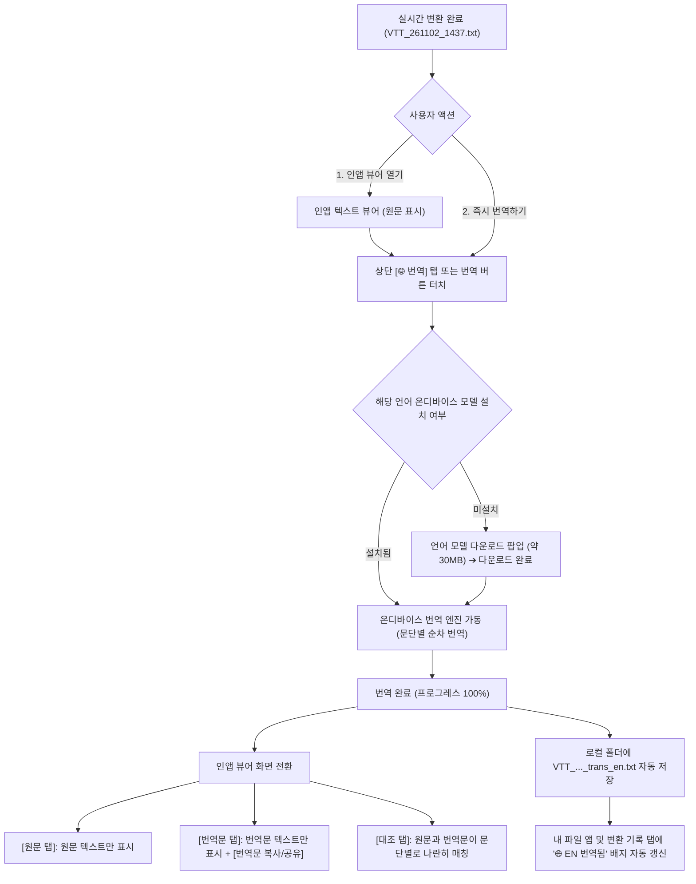

# 📱 VoiceToText 서비스 기획서 (PRD)
### 안드로이드 내부 오디오 실시간 텍스트 변환 + 로컬 파일(`Documents/VoiceToText`) 자동 저장 + 다국어 번역 앱

| 항목 | 내용 |
| :--- | :--- |
| 문서 버전 | **v3.0 (실시간 & 로컬 파일 다국어 자동 번역 기능 전면 도입)** |
| 최종 수정일 | 2026-11-02 |
| 문서 상태 | **검토 및 기능 승인 대기 (Draft for Review)** |
| 타겟 플랫폼 | **Android 13 (API 33) 이상** (minSdk 33 / targetSdk 35) |
| STT 엔진 | **안드로이드 기본 음성 인식기 (`SpeechRecognizer`)** — 한국어/English/日本語/자동감지 |
| 번역 엔진 | **Google ML Kit Translate (온디바이스 오프라인 번역 기본)** + 선택적 고품질 클라우드 API(DeepL/OpenAI) 확장 |
| 저장 방식 | **기기 내부 로컬 저장소 전용 (`Documents/VoiceToText/*.txt`)** — 원문 및 번역문 독립/병렬 보관 |

---

### 변경 이력
| 버전 | 일자 | 주요 변경 내용 |
| :--- | :--- | :--- |
| v1.0 | 2026-11-02 | 초안 작성 (Google Drive/Docs 연동 기반) |
| v1.1 | 2026-11-02 | STT 엔진(안드로이드 기본 인식기) 및 minSdk 33 확정 |
| v2.0 | 2026-11-02 | [로컬 전면 개편] Google Drive 의존성 완전 제거, 기기 내부 문서(`Documents/VoiceToText`) 자동 저장 |
| v2.1 | 2026-11-02 | [다국어 STT & 단축 파일명] 한국어/영어/일본어/자동감지 칩 바, 단축 파일명(`VTT_YYMMDD_HHmm.txt`), 순수 텍스트 포맷 |
| v2.2 | 2026-11-02 | [인앱 뷰어 & UX 완성] `InAppTextViewerDialog` 탑재, 하늘색/파란색 버튼 표준화, FlowRow 메타데이터 줄바꿈, 삭제 확인 다이얼로그 |
| **v3.0** | **2026-11-02** | **[다음 버전 신규 기능: 변환된 텍스트 다국어 자동 번역 엔진 탑재]**<br>• **온디바이스 오프라인 번역(Google ML Kit Translate)** 기본 탑재: 데이터 요금 및 외부 서버 유출 없는 100% 프라이버시 보호<br>• **인앱 뷰어 3-Way 탭**: `[원문]`, `[번역문]`, `[대조(나란히 보기)]` 원터치 전환<br>• **실시간 변환 중 실시간 자막 모드(Live Subtitle)**: 외국어 오디오 청취 시 실시간 한국어 자막 스트리밍<br>• **번역 파일 독립/병렬 저장 규격**: `VTT_YYMMDD_HHmm_trans_[lang].txt` 자동 생성<br>• **오프라인 언어팩(약 30MB) 관리 모달**: 한국어, 영어, 일본어, 중국어, 스페인어 등 50여 개 언어 모델 다운로드/삭제 |

---

## 1. 프로젝트 개요

### 1.1 배경 및 목적
기존 VoiceToText v2.2는 스마트폰 내부 사운드를 마이크 없이 캡처하여 깨끗한 텍스트 파일로 자동 저장하는 온디바이스 유틸리티로서 높은 완성도를 확보하였다.  
그러나 **유튜브 해외 강연, 글로벌 팟캐스트, 외국어 온라인 미팅, 해외 뉴스** 등을 시청하는 사용자들은 **"인식된 외국어 텍스트를 즉시 한국어로 읽고 싶다"**거나, 반대로 **"한국어 회의록을 영어/일본어 리포트로 즉시 변환하여 공유하고 싶다"**는 강력한 니즈를 가지고 있다.

v3.0에서는 기존의 **100% 오프라인 & 프라이버시 보호(Zero-Cloud)** 철학을 계승하면서, 기기 내부에서 스스로 구동되는 **온디바이스 번역 엔진(Google ML Kit Translate)**을 결합하여 **변환 완료 파일 번역** 및 **실시간 청취 중 자막 번역** 기능을 제공한다.

### 1.2 핵심 가치 (Core Value)
1. **100% 오프라인 & 프라이버시 유지 (On-Device Translation)**:
   - 번역 작업을 위해 텍스트를 제3자 외부 번역 서버로 전송하지 않고, 스마트폰 내부 NPU/CPU에서 로컬 머신러닝 모델로 직접 번역을 수행합니다. 기밀 회의록이나 개인 메모도 안심하고 번역할 수 있습니다.
2. **원문-번역문 직관적 비교 (Bilingual Parallel View)**:
   - 번역된 텍스트만 덩그러니 보여주는 것이 아니라, 문단 단위로 원문과 번역문을 나란히 비교하며 학습하거나 검토할 수 있는 인앱 대조 뷰어를 제공합니다.
3. **실시간 자막 스트리밍 (Live Subtitle Mode)**:
   - 영어 유튜브 영상을 들을 때 실시간으로 인식된 영어 문장 바로 아래에 한국어 해석 자막이 1~2초 내에 즉시 표시되어 실시간 번역 자막기 역할을 합니다.
4. **표준 번역 파일 영구 보관 (Export & Portability)**:
   - 번역문 전용 텍스트 파일(`*_trans_en.txt`) 및 대조 텍스트 파일(`*_bilingual.txt`)을 로컬 문서 폴더에 자동으로 생성하여, 외부 메신저나 PC로 손쉽게 내보낼 수 있습니다.

### 1.3 기능 범위 (Scope v3.0)
| 구분 | v2.2 (현재 배포본) | **v3.0 (신규 추가 및 확장 기능)** |
| :--- | :--- | :--- |
| **번역 엔진** | 없음 | • **Google ML Kit On-Device Translation (오프라인 50+개 언어)**<br>• (선택 확장) 사용자 API Key 기반 DeepL / OpenAI 클라우드 정밀 번역 |
| **파일 번역 (Batch)** | 없음 | • 완료 화면 및 기록 상세 화면에서 **[🌐 번역하기]** 원터치 실행<br>• 언어 선택: 한국어, English, 日本語, 中文, Español, Deutsch 등<br>• 실시간 번역 진행률 표시 (프로그레스 바) |
| **실시간 자막 (Live)** | 원문만 텍스트 표시 | • 변환 중 화면에서 **[실시간 번역 자막]** 토글 스위치<br>• 원문 문장 바로 아래 번역 자막 카드 실시간 스트리밍 |
| **인앱 뷰어 3-Way** | 원문 단독 열람 | • **[원문]** / **[번역문]** / **[대조(나란히 보기)]** 3단 탭 전환<br>• 원문 복사, 번역문 복사, 대조문 전체 복사 및 공유 분리 |
| **저장 파일 규격** | 원문 1개 파일만 저장 | • 번역 파일 자동 저장: `VTT_YYMMDD_HHmm_trans_[lang].txt`<br>• 대조 파일 저장: `VTT_YYMMDD_HHmm_bilingual.txt` |
| **언어팩 관리** | 없음 | • 오프라인 번역 모델 팩(언어당 약 30MB) 다운로드/삭제 관리 바텀시트 |

---

## 2. 핵심 변경 및 의사결정 (v3.0)

| No | 구분 | v2.2 사양 | **v3.0 신규 사양** | 의사결정 근거 |
| :--- | :--- | :--- | :--- | :--- |
| **D-12** | **번역 엔진 선택** | 번역 기능 없음 | **Google ML Kit Translate (온디바이스) 기본 적용** | VoiceToText의 핵심 가치(오프라인 사용성, 제로 비용, 완전 프라이버시)를 100% 계승하기 위함 |
| **D-13** | **인앱 뷰어 UX** | 단일 스크롤 뷰 | **`[원문] | [번역문] | [대조]` 3-Way 세그먼트 탭** | 외국어 학습자 및 비즈니스 사용자가 번역 품질을 즉시 교차 검증할 수 있도록 대조 뷰 필수 제공 |
| **D-14** | **번역 파일 명명** | `VTT_YYMMDD_HHmm.txt` 단일 | **원문: `VTT_...txt`<br>번역문: `VTT_..._trans_en.txt`<br>대조문: `VTT_..._bilingual.txt`** | 파일 관리자(내 파일)에서 원문과 번역본의 관계를 직관적으로 파악하고 독립 공유 가능 |
| **D-15** | **실시간 번역 방식** | 문장 완성 후 수동 확인 | **확정 문장(`onSegmentResults`) 단위 실시간 비동기 번역 큐** | 실시간 오디오 캡처 루프에 지연(Lag)을 주지 않으면서도 화면에 1초 내로 자막을 띄우는 코루틴 파이프라인 구축 |
| **D-16** | **액션 버튼 컬러** | 텍스트 열기(하늘색), 공유(파란색) | **번역 실행/번역 열기: 인디고/바이올렛 (`#6366F1` / `#4F46E5`)** | 기존 하늘색(파일 열기), 파란색(공유), 녹색(저장 완료)과 겹치지 않는 AI/번역 고유 시각 언어 부여 |

---

## 3. 요구사항 상세 매핑 (Requirements Mapping)

| 번호 | 요구사항 명세 | 세부 구현 방안 |
| :--- | :--- | :--- |
| **REQ-12** | 변환 완료 문서 다국어 번역 | 변환 완료 화면 및 기록 상세 화면에 `[🌐 번역하기]` 버튼 배치 ➔ 타겟 언어 선택 ➔ ML Kit 코루틴 배치 번역 수행 |
| **REQ-13** | 인앱 텍스트 뷰어 대조 모드 | `InAppTextViewerDialog` 상단에 3단 탭 배치. 대조 모드 선택 시 좌우(가로) 또는 상하(세로)로 원문/번역문 문단 매칭 렌더링 |
| **REQ-14** | 실시간 변환 중 실시간 자막 | 변환 중 화면 우측 상단에 `[자막 번역 🌐 ON/OFF]` 칩 제공. 음성 인식 문장이 확정될 때마다 즉시 번역하여 원문 하단에 자막 카드로 표시 |
| **REQ-15** | 오프라인 언어팩 다운로드 관리 | 최초 미설치 언어 번역 요청 시 안내 다이얼로그 노출 (약 30MB 와이파이/데이터 다운로드 동의) ➔ 저장소 관리 시트에서 모델 삭제 지원 |
| **REQ-16** | 번역 파일 자동 로컬 저장 | 번역 완료 시 `Documents/VoiceToText` 폴더에 `VTT_YYMMDD_HHmm_trans_[lang].txt` 자동 기록 및 Room DB 메타데이터 연결 |

---

## 4. 사용자 플로우 (User Journey Flow)



---

## 5. 번역 파일 저장 규격 (File Specification)

### 5.1 파일 명명 규칙
1. **원문 파일**: `VTT_261102_1437.txt` (기존 동일)
2. **번역문 단독 파일**: `VTT_261102_1437_trans_en.txt` (언어 코드: `en`, `ja`, `zh`, `ko`, `es` 등)
3. **원문+번역문 대조 파일 (옵션)**: `VTT_261102_1437_bilingual.txt`

### 5.2 번역문 텍스트 파일 포맷 규격 (`*_trans_en.txt`)
```text
[번역 시작: 2026-11-02 14:40:05 | 원문: 한국어 -> 번역: English | 모델: On-Device ML Kit]

Craig made eye contact with Barbara. He winked. She didn't. She didn't even smile. In his old gift box, old letters and black-and-white photos were neatly organized.

She ran to her husband, who had just finished a job and was having a beer in the garage before hitting the rocks. The husband, a large truck driver over 195cm tall, listened quietly to his wife.

In this way, using the local storage method eliminates the need for any authentication process, and your voice is securely preserved as text even in a completely offline environment.

[번역 완료: 3개 문단 | 소요 시간: 1.2초]
```

### 5.3 대조 텍스트 파일 포맷 규격 (`*_bilingual.txt`)
```text
[대조 리포트: 한국어 / English | VTT_261102_1437]

[01] 원문: 크레이그는 바버라와 눈을 맞췄다 그는 윙크했다 그녀는 하지 않았다 심지어 웃지도 않았다...
[01] 번역: Craig made eye contact with Barbara. He winked. She didn't. She didn't even smile...

[02] 원문: 남편에게 달려갔고 그 남자는 일을 하나 끝내고 바위를 하기 전에 차고에서 맥주를 한잔하고 있었다...
[02] 번역: She ran to her husband, who had just finished a job and was having a beer in the garage...

[03] 원문: 이와 같이 로컬 저장 방식을 사용하면 인증 과정이 전혀 필요 없고...
[03] 번역: In this way, using the local storage method eliminates the need for any authentication process...
```

---

## 6. 화면별 기능 상세 사양

### 6.1 인앱 텍스트 뷰어 (`InAppTextViewerDialog`) 번역 UI
* **상단 헤더**:
  - 파일명: `VTT_261102_1437.txt`
  - 타겟 언어 선택 드롭다운 칩: `🇰🇷 원문` ➔ `🇺🇸 English` (또는 🇯🇵 日本語, 🇨🇳 中文)
* **3-Way 세그먼트 탭**:
  - `[원문]` : 원문 텍스트만 스크롤
  - `[번역문]` : 번역문 텍스트만 스크롤 (원문 타임로그 제외 깔끔한 문단)
  - `[대조]` : 문단별로 원문(상단) + 번역문(하단 연파랑 박스) 순차 교차 표시
* **하단 버튼 바 (동적 전환)**:
  - 번역문 탭일 때: `[번역문 복사]`, `[번역문 공유 (파랑)]`, `[닫기]`
  - 대조 탭일 때: `[대조문 복사]`, `[대조문 공유 (파랑)]`, `[닫기]`

### 6.2 실시간 변환 화면 (`LiveTranscribeScreen`) 실시간 자막 모드
* **실시간 번역 스위치 토글**:
  - 상단 앱바 아래: `[자막 번역: 끄기 / 켜기(🌐 ➔ 🇰🇷 한국어)]`
* **자막 카드 렌더링**:
  - 실시간 오디오가 음성인식되어 문장이 확정(`Segment`)되는 순간 백그라운드 번역 코루틴 호출 (소요시간 약 300~500ms).
  - 스크립트 리스트에서 원문 문장 바로 아래에 은은한 블루 배경 카드(`Surface-Container-Highest`)로 한국어 번역문이 실시간 부착되어 스크롤됨.

### 6.3 변환 완료 화면 (`CompletedScreen`)
* 요약 카드 하단 버튼 배치:
  - 1열: `[📄 텍스트 열기 (하늘색 #0284C7)]`
  - 2열: `[🌐 텍스트 번역하기 (인디고 #6366F1)]` (원터치로 즉시 번역 모달 실행)
  - 3열: `[📋 전체 복사]` + `[🔗 공유하기 (파란색 #2563EB)]`

### 6.4 변환 기록 목록 (`HistoryScreen`)
* 카드 태그:
  - 원문만 있는 경우: `🇰🇷 한국어`, `1분 4초`, `1002 B`, `✓ 저장 완료`
  - 번역 완료된 경우: `🌐 EN 번역됨` 인디고 칩 추가 표시
* 필터 칩:
  - `[전체]`, `[오늘]`, `[이번 주]`, `[이번 달]`, `[🌐 번역됨]`

### 6.5 오프라인 언어팩 관리 모달 (`LanguageModelManager`)
* **위치**: 저장소 관리 바텀시트(`StorageBottomSheet`) 내 **[오프라인 번역 언어팩 관리]** 항목
* **기능**:
  - 설치된 언어팩 목록 및 용량(예: 영어 모델 32 MB, 일본어 모델 29 MB)
  - 미설치 언어팩 옆 `[다운로드]` 아이콘
  - 설치된 언어팩 우측 `[삭제]` 아이콘 (기기 저장공간 절약)

---

## 7. 기술 구현 요약 (Technical Architecture)

1. **Google ML Kit Translate 라이프사이클**:
   ```kotlin
   val options = TranslatorOptions.Builder()
       .setSourceLanguage(TranslateLanguage.KOREAN)
       .setTargetLanguage(TranslateLanguage.ENGLISH)
       .build()
   val translator = Translation.getClient(options)
   
   // 모델 다운로드 조건 (와이파이 선호, 자동 캐시)
   val conditions = DownloadConditions.Builder().requireWifi().build()
   translator.downloadModelIfNeeded(conditions)
       .addOnSuccessListener {
           translator.translate(sourceText)
               .addOnSuccessListener { translatedText ->
                   // 번역 결과 UI 및 DB/파일 저장
               }
       }
   ```
2. **배치 번역 및 Room DB 스키마 확장**:
   - `DocumentEntity`에 `translatedText`, `targetLanguage`, `translatedFilePath` 컬럼 추가 (Migration 2 -> 3).
3. **비동기 번역 코루틴**:
   - 대용량 텍스트 번역 시 UI 끊김(Jank) 방지를 위해 `Dispatchers.Default`에서 문단 단위 병렬/순차 스트림 처리.

---

## 8. 수용 기준 (Acceptance Criteria v3.0)

- [ ] **AC-13**: 인터넷 연결이 끊긴 비행기 모드에서도 이미 다운로드된 언어팩을 통해 100% 정상적으로 번역이 동작해야 한다.
- [ ] **AC-14**: 인앱 뷰어에서 [원문], [번역문], [대조] 탭을 터치했을 때 딜레이 없이 3가지 뷰가 즉시 전환되어야 한다.
- [ ] **AC-15**: 번역 완료 시 기기 `Documents/VoiceToText/` 경로에 `*_trans_[lang].txt` 파일이 즉시 생성되어야 한다.
- [ ] **AC-16**: 실시간 자막 모드 활성화 시 음성 인식 확정 문장 아래에 1초 이내로 번역 자막 카드가 연속적으로 표시되어야 한다.
- [ ] **AC-17**: 언어 모델 다운로드 전 사용자 동의 다이얼로그가 표시되고, 필요 없을 때 언제든 언어 모델을 삭제할 수 있어야 한다.
- [ ] **AC-18**: 가로 2-Pane 모드에서도 좌측/우측 패널에 원문과 번역문 대조 뷰가 잘림이나 세로 찌그러짐 없이 쾌적하게 렌더링되어야 한다.
